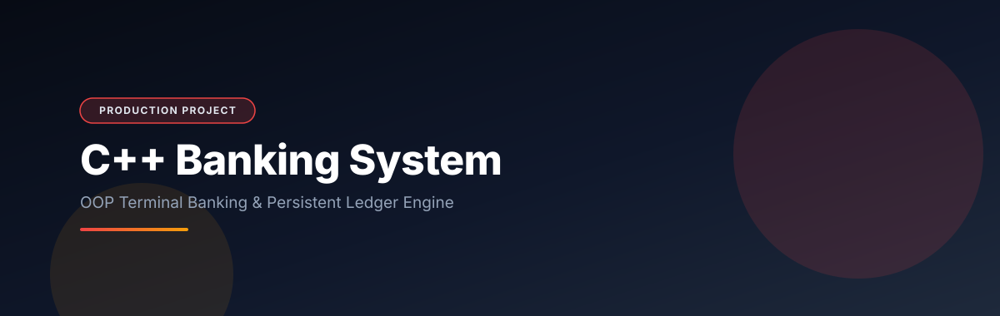
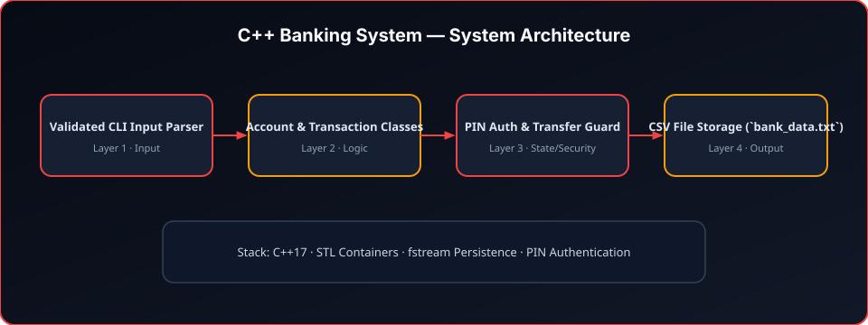
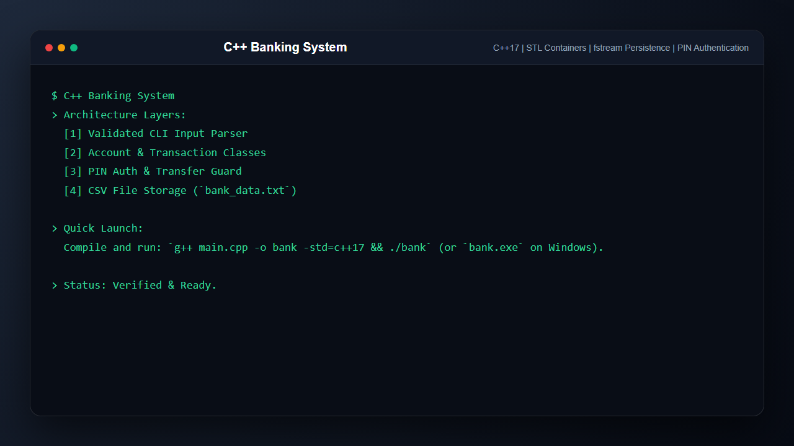

# C++ Banking System

> OOP Terminal Banking & Persistent Ledger Engine

    



## 📌 Executive Overview
C++17 object-oriented console banking system with PIN verification, deposits, withdrawals, self-transfer protection, account statements, and persistent `bank_data.txt` storage.

---

## 🏛️ System Architecture



---

## 🖥️ Interface & CLI Preview



---

## 🛠️ Tech Stack
- **C++17**
- **STL Containers**
- **fstream Persistence**
- **PIN Authentication**

---

## 🚀 How to Run

1. **Clone the repository:**
   ```bash
   git clone https://github.com/royalodi/cpp-bank-system.git
   cd cpp-bank-system
   ```

2. **Launch locally:**
   Compile and run: `g++ main.cpp -o bank -std=c++17 && ./bank` (or `bank.exe` on Windows).

---

## 👨‍💻 Author & Lead Maintainer

<table>
  <tr>
    <td align="center" width="150" valign="middle">
      <a href="https://github.com/royalodi">
        
      </a>
      <br /><br />
      <b>Royal Odi</b><br />
      <sub><i>Full-Stack Engineer</i></sub>
    </td>
    <td valign="top">
      <p>
        Designed, engineered, and maintained by <b>Royal Odi</b>. Full-Stack Engineer focused on building scalable web architectures, robust backend systems, and responsive, high-performance digital experiences.
      </p>
      <p>
        <a href="https://github.com/royalodi"></a>
        <a href="mailto:royalodi.dev@gmail.com"></a>
        <a href="https://github.com/royalodi?tab=repositories"></a>
      </p>
    </td>
  </tr>
</table>

---

## 📄 License
Distributed under the **MIT License**.
